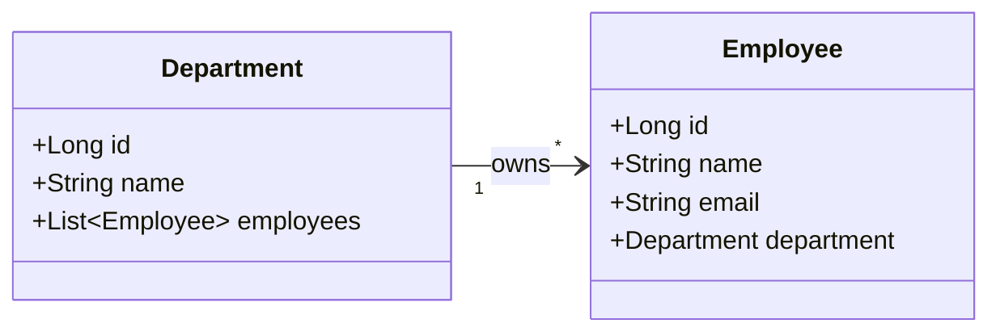
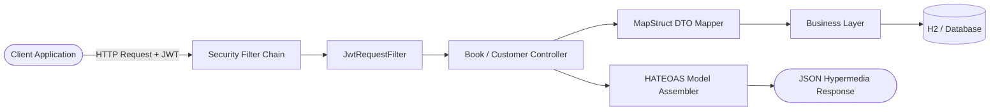
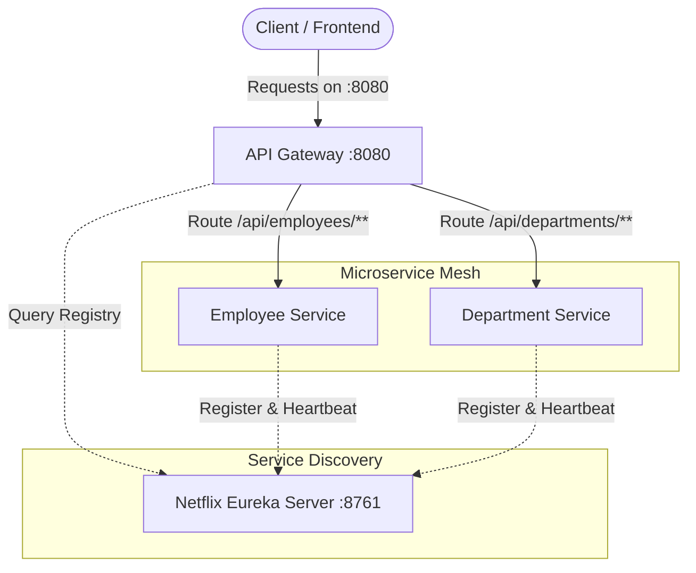

# Digital Nurture Java Full Stack Engineering (FSE)

[](https://www.oracle.com/java/)
[](https://spring.io/projects/spring-boot)
[](https://spring.io/projects/spring-cloud)
[](https://react.dev/)
[](https://www.mysql.com/)
[](https://junit.org/junit5/)
[](https://git-scm.com/)

---

## Author Profile

| Field | Details |
| :--- | :--- |
| **Name** | **Vaibhav Verma** |
| **SuperSet ID** | **6823384** |
| **Institutional Email** | [vaibhav.verma3_cs23@gla.ac.in](mailto:vaibhav.verma3_cs23@gla.ac.in) |
| **Personal Email** | [vaibhavverma0687@gmail.com](mailto:vaibhavverma0687@gmail.com) |
| **GitHub Repository** | [vaibhavverma389/digital-nurture-java-fse](https://github.com/vaibhavverma389/digital-nurture-java-fse) |
| **Program** | **Digital Nurture Java Full Stack Engineering (FSE)** |

---

## Executive Program Overview

This repository contains the complete portfolio of hands-on exercises, industry-aligned mini-projects, cloud-native microservices architectures, full-stack web applications, database engineering scripts, and professional certifications completed during the **Digital Nurture Java Full Stack Engineering (FSE)** curriculum.

The repository spans **12 comprehensive modules & asset tracks**:
1. **Certifications & Accreditations**: 8 industry certifications covering Generative AI, Agentic AI, Prompt Engineering, React, Selenium Automation, GitHub Copilot, and Agile Methodologies.
2. **Core Java & Data Structures & Algorithms (DSA)**: Algorithmic complexity analysis ($O(1)$, $O(\log n)$, $O(n)$, $O(n \log n)$, $O(n^2)$), searching, sorting, and custom linear data structures.
3. **Software Design Patterns & SOLID Principles**: GoF Creational, Structural, and Behavioral patterns implemented with real-world scenarios.
4. **Relational Database Design & Oracle PL/SQL**: 870+ lines of enterprise banking schema, stored procedures, triggers, functions, cursors, and modular packages.
5. **Spring Framework Core & Spring Boot Fundamentals**: IoC Container, Dependency Injection, Spring AOP execution profiling, and Maven build automation.
6. **Spring Data JPA, Hibernate, Projections & Caching**: Entity relations, JPQL/native queries, DTO projections, Hibernate L2 caching, and auditing.
7. **Enterprise REST APIs, Spring Security & Documentation**: RESTful CRUD with Spring Boot 3, MapStruct DTOs, Bean Validation, HATEOAS hypermedia, OpenAPI 3/Swagger, JWT authentication, and Actuator metrics.
8. **Cloud-Native Microservices Architecture**: Service Registry (Eureka), API Gateway, dynamic routing, load balancing, and multi-service orchestration.
9. **Microservices Resilience & Enterprise Testing Suite**: Spring Security OAuth2/JWT, Spring Cloud OpenFeign inter-service communication, Config Server, Resilience4j Circuit Breakers, and distributed tracing.
10. **Full-Stack Upskilling Track**: 10 HTML5 modules, 11 CSS3 exercises, 14 JavaScript ES6+ modules, 25 advanced SQL queries, and 39 Core & Modern Java deep dives (Virtual Threads, Records, Pattern Matching, Reflection, TCP Sockets, JDBC Transactions).
11. **React.js Frontend Development**: 19 progressive Hands-on Labs spanning component hierarchies, JSX, state, hooks, Context API, controlled forms, Axios REST clients, and Jest/RTL unit tests.
12. **Git Version Control Hands-on Labs**: 5 labs covering repository setup, .gitignore, branching workflows, three-way merge conflict resolution, and remote tracking.

---

## Professional Certifications & Accreditations

The `Certifications/` directory contains official credentials and certifications achieved by **Vaibhav Verma**:

| # | Certification Title | Domain | Document Link |
| :-: | :--- | :--- | :--- |
| 1 | **Frontend React Engineer [101-BASIC]** | Frontend Engineering & React.js | [View Certificate](Certifications/Vaibhav_verma_Frontend_React_Engineer_[101-BASIC].pdf) |
| 2 | **Introduction to Agentic AI** | Artificial Intelligence & Autonomous Agents | [View Certificate](Certifications/Vaibhav_verma_Introduction_to_Agentic_AI.pdf) |
| 3 | **Foundations of Modern AI** | Machine Learning & AI Principles | [View Certificate](Certifications/Vaibhav_verma_Foundations_of_Modern_AI.pdf) |
| 4 | **Fundamentals of Generative AI** | Generative Models & LLM Foundations | [View Certificate](Certifications/Vaibhav_verma_FUNDAMENTALS_OF_GENERATIVE_AI.pdf) |
| 5 | **Prompt Engineering Foundation** | Generative AI & Prompt Design | [View Certificate](Certifications/Vaibhav_verma_Prompt_Engineering_Foundation.pdf) |
| 6 | **GitHub Copilot Fundamentals Virtual Training** | AI-Assisted Software Development | [View Certificate](Certifications/Vaibhav_verma_GitHub_Copilot_Fundamentals_Virtual_Training.pdf) |
| 7 | **Selenium Interactive Course [101-BASIC]** | Automated Quality Assurance & Testing | [View Certificate](Certifications/Vaibhav_verma_Selenium_Interactive_Course_[101-BASIC].pdf) |
| 8 | **ITPM - Introduction to Agile [101-Basics]** | Agile Project Management & Scrum | [View Certificate](Certifications/Vaibhav_verma_ITPM_-_Introduction_to_Agile_[101-Basics].pdf) |

---

## Repository Architecture & Directory Structure

```text
digital-nurture-java-fse/
├── Certifications/                     # Official Professional Certification Documents
│   ├── Vaibhav_verma_Foundations_of_Modern_AI.pdf
│   ├── Vaibhav_verma_Frontend_React_Engineer_[101-BASIC].pdf
│   ├── Vaibhav_verma_FUNDAMENTALS_OF_GENERATIVE_AI.pdf
│   ├── Vaibhav_verma_GitHub_Copilot_Fundamentals_Virtual_Training.pdf
│   ├── Vaibhav_verma_Introduction_to_Agentic_AI.pdf
│   ├── Vaibhav_verma_ITPM_-_Introduction_to_Agile_[101-Basics].pdf
│   ├── Vaibhav_verma_Prompt_Engineering_Foundation.pdf
│   └── Vaibhav_verma_Selenium_Interactive_Course_[101-BASIC].pdf
├── Git/                                # Git Version Control Hands-on Labs (HOL 1-5)
│   ├── 1. Git-HOL/                     # Config, init, add, commit, remote origin, push/pull
│   ├── 2. Git-HOL/                     # .gitignore rules for logs and build directories
│   ├── 3. Git-HOL/                     # Branch creation, switching, feature merging, branch deletion
│   ├── 4. Git-HOL/                     # Merge conflict resolution with mergetool, conflict markers
│   └── 5. Git-HOL/                     # Tracking remote branches (origin/master), log diffing
├── JUnit_Basic Testing/                # Enterprise Microservices, Security & Testing Suite
│   ├── ex1/                            # Security & Auth (OAuth2 Client, Resource Server, JWT)
│   │   ├── 1.1/                        # Spring Security OAuth2 Client Configuration
│   │   ├── 1.2/                        # Spring Security Resource Server (Bearer Token)
│   │   └── 1.3/                        # Stateless JWT Authentication (JwtTokenFilter & Provider)
│   ├── ex2/                            # Spring Cloud Gateway Configuration
│   │   ├── 2.1/                        # Global & Route Logging Filter
│   │   ├── 2.2/                        # Reactive Load Balancer Configuration
│   │   └── 2.3/                        # Resilience4j Circuit Breaker & Fallback Mechanisms
│   ├── ex3/                            # Microservice Inter-Service Communication & Discovery
│   │   ├── 3.1/                        # OpenFeign Client: Order-Service <-> User-Service
│   │   ├── 3.2/                        # Spring Cloud Config Server & Eureka Service Discovery
│   │   ├── 3.3/                        # Distributed Tracing, Sleuth, Kafka/RabbitMQ Config
│   │   └── 3.4/                        # Payment Microservice Processing
│   └── ex4/                            # Cognizant Microservices Banking Suite
│       ├── 4.1/                        # Account Microservice & Loan Microservice
│       ├── 4.2/                        # Eureka Discovery Server with Multi-Service Registration
│       ├── 4.3/                        # Greet Microservice REST Endpoint
│       └── 4.4/                        # API Gateway with Custom Log Filter
├── Microservices/                      # Production Cloud-Native Microservices Ecosystem
│   ├── eureka-server/                  # Netflix Eureka Service Discovery Registry (Port: 8761)
│   ├── api-gateway/                    # Spring Cloud Gateway with Load Balanced Routes (Port: 8080)
│   ├── department-service/             # Department Management Microservice
│   └── employee-service/               # Employee Management Microservice
├── react/                              # React.js Modern Frontend Development (19 Labs)
│   ├── 1. ReactJS-HOL/ to 18. ReactJS-HOL/ # Create-React-App component implementations
│   └── 19. ReactJS-HOL/                # Asynchronous API testing with Axios Mock Adapter
├── Upskilling/                         # Full-Stack Engineering Deep Dive
│   ├── Module1 html/                   # 10 HTML5 Exercises (Semantic tags, Forms, Geolocation, Storage)
│   ├── Module1 css/                    # 11 CSS3 Exercises (Flexbox, Grid, Animations, Responsive layouts)
│   ├── Module1 javascript/             # 14 JS Exercises (DOM, ES6+, Promises, Async/Await, Fetch API)
│   ├── Module2 ani sql/                # 25 Enterprise SQL Queries (Joins, Aggregations, Window Functions)
│   └── Module3 java/                   # 39 Advanced Java Topics (Virtual Threads, Records, Sockets, JDBC)
├── Week_1/                             # Data Structures & Algorithms in Java (7 Projects)
│   ├── Ecommerce Platf Search Funct/   # Linear vs Binary Search on Product datasets
│   ├── Employee Management System/     # Array-based CRUD management with capacity resizing
│   ├── Financial Forecasting/          # Recursive algorithms for compound growth forecasting
│   ├── Inventory Management System/    # Dynamic inventory tracking and product management
│   ├── Library Management System/      # Title-based linear and binary book lookup algorithms
│   ├── Sorting_Customer_Orders/        # Bubble Sort vs Quick Sort algorithm performance
│   └── Task Management System/         # Custom Singly Linked List for Task CRUD operations
├── Week_2/                             # Software Engineering Design Patterns (9 Patterns)
│   ├── Implementing the Singleton Pattern/     # Double-checked locking thread-safe Logger
│   ├── Implementing the Factory Method Pattern/# Document creation factory (Word, PDF, Excel)
│   ├── Implementing the Builder Pattern/       # Complex object construction (Computer.Builder)
│   ├── Implementing the Adapter Pattern/       # Payment adapter (PayPalGateway, StripeGateway)
│   ├── Implementing the Decorator Pattern/     # Notification decorators (Email, SMS, Slack)
│   ├── Implementing the Proxy Pattern/         # Virtual proxy with caching (ProxyImage, RealImage)
│   ├── Implementing the Command Pattern/       # Encapsulated command invoker (RemoteControl, Light)
│   ├── Implementing the Strategy Pattern/      # Interchangeable payment algorithms (CreditCard, PayPal)
│   └── Implementing Dependency Injection/      # Decoupled repository injection into service
├── Week_3/                             # Relational Databases & Advanced Oracle PL/SQL
│   └── WEEK 2 PLSQL.sql                # 877-line comprehensive banking database script
├── Week_4/                             # Spring Framework Core, IoC, AOP & Spring Boot (9 Exercises)
│   ├── Exercise 1 to 8/                # Spring IoC, DI, XML vs Annotations, AOP Profiling
│   ├── Exercise 9/                     # Spring Boot REST CRUD for Library Management
│   └── LibraryManagement/              # Maven Spring Core multi-aspect application
├── Week_5/                             # Spring Data JPA, Hibernate, Projections & Caching
│   └── EmployeeManagementSystem/       # Auditing, Projections, Named Queries, L2 Cache, Pagination
├── Week_6/                             # Enterprise RESTful Web Services & Production Security
│   └── BookstoreAPI/                   # Spring Boot 3, MapStruct, HATEOAS, OpenAPI, JWT, Actuator
└── README.md                           # Master Project Documentation
```

---

## Detailed Module Documentation

### Module 1: Week 1 — Data Structures & Algorithms (Core Java)

This module implements foundational and advanced data structures and algorithms, emphasizing **time complexity** ($O(1)$, $O(\log n)$, $O(n)$, $O(n \log n)$, $O(n^2)$) and **space complexity**.

| Lab Directory | Key Concepts & Classes | Time Complexity | Problem Description |
| :--- | :--- | :--- | :--- |
| **`Ecommerce Platf Search Funct`** | `ProductSearch.java`, `Product.java` | Linear: $O(n)$<br>Binary: $O(\log n)$ | Implements both Linear Search and Binary Search on sorted product arrays. Demonstrates binary search efficiency over $O(n)$ iteration. |
| **`Employee Management System`** | `EmployeeManager.java`, `Employee.java`, `Main.java` | Add: $O(1)$<br>Search: $O(n)$<br>Delete: $O(n)$ | In-memory employee management using arrays with capacity checking, sequential search by ID, and array compaction upon deletion. |
| **`Financial Forecasting`** | `FinancialForecasting.java` | Recursive: $O(2^n)$ or $O(n)$ | Predicts future asset values using recursive calculation based on past growth rates. Analyzes recursion depth and stack limits. |
| **`Inventory Management System`** | `Inventory.java`, `Product.java` | Lookup: $O(1)$<br>Update: $O(1)$ | High-throughput inventory tracking using key-value indexing for real-time stock deductions and price updates. |
| **`Library Management System`** | `BookSearch.java`, `Book.java` | Linear: $O(n)$<br>Binary: $O(\log n)$ | Search engine for book titles comparing unindexed linear scanning against lexicographically sorted binary search. |
| **`Sorting_Customer_Orders`** | `OrderSorting.java`, `Order.java` | Bubble: $O(n^2)$<br>QuickSort: $O(n \log n)$ | Compares quadratic sorting (Bubble Sort) with divide-and-conquer sorting (Quick Sort) on order arrays by total cost. |
| **`Task Management System`** | `TaskManager.java`, `SinglyLinkedList`, `Node`, `Task` | Insert: $O(1)$<br>Traverse: $O(n)$ | Custom Singly Linked List implementation from scratch supporting node insertion at head/tail, searching, and deletion by Task ID. |

---

### Module 2: Week 2 — Software Design Patterns & SOLID Principles

Implements 9 Gang of Four (GoF) design patterns and software architectural principles with clean OOP design:

1. **Singleton Pattern (`Implementing the Singleton Pattern`)**:
   - `Logger.java`: Thread-safe singleton using **double-checked locking** (`synchronized (Logger.class)`). Ensures a single shared logging instance across the JVM.
   - `SingletonTest.java`: Verifies reference equality (`logger1 == logger2`).

2. **Factory Method Pattern (`Implementing the Factory Method Pattern`)**:
   - `Document.java`, `WordDocument.java`, `PdfDocument.java`, `ExcelDocument.java`
   - `DocumentFactory.java`, `WordDocumentFactory.java`, `PdfDocumentFactory.java`, `ExcelDocumentFactory.java`
   - Encapsulates object instantiation, allowing client code to depend on the `Document` abstraction rather than concrete classes.

3. **Builder Pattern (`Implementing the Builder Pattern`)**:
   - `Computer.java`: Implements a static nested `Builder` class with fluent setter chaining (`setCPU()`, `setRAM()`, `setStorage()`, `setGraphicsCardEnabled()`).
   - Prevents telescoping constructor anti-patterns for complex domain objects.

4. **Adapter Pattern (`Implementing the Adapter Pattern`)**:
   - `PaymentProcessor.java`: Target interface defining `processPayment(double amount)`.
   - Adaptees: Incompatible legacy/third-party SDKs (`PayPalGateway.makePayment()`, `StripeGateway.charge()`).
   - Adapters: `PayPalAdapter.java`, `StripeAdapter.java` translate interface calls seamlessly.

5. **Decorator Pattern (`Implementing the Decorator Pattern`)**:
   - Component: `Notifier.java` and base `EmailNotifier.java`.
   - Decorators: `NotifierDecorator.java`, `SMSNotifierDecorator.java`, `SlackNotifierDecorator.java`.
   - Dynamically attaches additional responsibilities (SMS, Slack alerts) at runtime without modifying the underlying class hierarchy.

6. **Proxy Pattern (`Implementing the Proxy Pattern`)**:
   - Subject: `Image.java`.
   - Real Subject: `RealImage.java` (simulates heavy disk/network loading).
   - Proxy: `ProxyImage.java` implements **Virtual Proxy** with lazy loading and local caching.

7. **Command Pattern (`Implementing the Command Pattern`)**:
   - Receiver: `Light.java` with `on()` and `off()`.
   - Commands: `Command.java`, `LightOnCommand.java`, `LightOffCommand.java`.
   - Invoker: `RemoteControl.java` decouples request execution from request issuance.

8. **Strategy Pattern (`Implementing the Strategy Pattern`)**:
   - Context: `PaymentContext.java`.
   - Strategy Interface: `PaymentStrategy.java`.
   - Concrete Strategies: `CreditCardPayment.java`, `PayPalPayment.java`. Enables runtime switching of payment algorithms.

9. **Dependency Injection (`Implementing Dependency Injection`)**:
   - `CustomerRepository.java`, `CustomerRepositoryImpl.java`.
   - `CustomerService.java`: Eliminates tight coupling by injecting the repository dependency through the constructor (`Constructor Injection`).

---

### Module 3: Week 3 — Relational Databases & Advanced Oracle PL/SQL

The `Week_3\WEEK 2 PLSQL.sql` script (877 lines) implements a full enterprise financial database system in Oracle PL/SQL:

#### 1. Schema Architecture
- **`CUSTOMERS`**: `CustomerID` (PK), `Name`, `DOB`, `Balance`, `LastModified`.
- **`ACCOUNTS`**: `AccountID` (PK), `CustomerID` (FK), `AccountType`, `Balance`, `LastModified`.
- **`TRANSACTIONS`**: `TransactionID` (PK), `AccountID` (FK), `TransactionDate`, `Amount`, `TransactionType`.
- **`LOANS`**: `LoanID` (PK), `CustomerID` (FK), `LoanAmount`, `InterestRate`, `StartDate`, `EndDate`.
- **`EMPLOYEES`**: `EmployeeID` (PK), `Name`, `Position`, `Salary`, `Department`, `HireDate`.

#### 2. Advanced Stored Procedures
- `SafeTransferFunds(p_from_acc, p_to_acc, p_amount)`: Transaction-safe balance transfer with explicit exception handling and `ROLLBACK` on insufficient funds.
- `ProcessMonthlyInterest()`: Computes and credits 1% interest to all active savings accounts via cursor looping.
- `UpdateSalary(p_emp_id, p_percentage)`: Applies percentage-based salary increments with validation.
- `UpdateEmployeeBonus(p_dept, p_bonus_pct)`: Bulk bonus calculation for specific departments.

#### 3. Stored Functions
- `CalculateAge(p_dob)`: Calculates precise chronological age from date of birth.
- `CalculateMonthlyInstallment(p_amount, p_rate, p_tenure_years)`: Financial EMI calculator based on amortization formula.
- `HasSufficientBalance(p_account_id, p_amount)`: Returns Boolean check for overdraft prevention.

#### 4. Triggers
- `UpdateCustomerLastModified`: `BEFORE UPDATE` trigger automatically updating timestamp audit fields.
- `LogTransactions`: `AFTER INSERT` trigger capturing audit trail entries into an audit log.
- `CheckTransactionRules`: `BEFORE INSERT` trigger validating withdrawal limits against available balance.

#### 5. Modular Packages
- **`CustomerManagement`**: Modular package for onboarding customers, updating KYC profiles, and retrieving customer status.
- **`EmployeeManagement`**: Centralized package managing salary reviews, appraisals, and employee exits.
- **`AccountOperations`**: High-security package for account opening, closing, transfers, and balance inquiries.

---

### Module 4: Week 4 — Spring Framework Core, IoC, AOP & Spring Boot

Progressive hands-on exercises mastering Spring Framework fundamentals:

- **Exercise 1 (`Basic Spring Configuration`)**: Configuring Spring IoC container with XML-based metadata (`applicationContext.xml`), instantiating `BookRepository` and `BookService`.
- **Exercise 2 (`Dependency Injection`)**: Wiring beans using setter injection and constructor injection in XML.
- **Exercise 3 (`Spring AOP Logging`)**: Integrating AspectJ; configuring `LoggingAspect` with `@Before` and `@After` advice to log service execution.
- **Exercise 4 (`Maven Project Structure`)**: Standardizing directory layout (`src/main/java`, `src/test/java`, `pom.xml`) and dependency lifecycle management.
- **Exercise 5 (`Spring IoC Container`)**: Exploring bean lifecycle callbacks (`init-method`, `destroy-method`).
- **Exercise 6 (`Annotation-Based Configuration`)**: Replacing XML wiring with stereotype annotations (`@Component`, `@Repository`, `@Service`, `@Autowired`).
- **Exercise 7 (`Constructor vs Setter Injection`)**: Comparing injection patterns and best practices for immutability.
- **Exercise 8 (`AOP Performance Profiling`)**: Implementing `@Around("execution(* com.library.service.*.*(..))")` to calculate method execution duration in milliseconds.
- **Exercise 9 (`Spring Boot REST Library Management`)**: Transitioning to Spring Boot 3; building a production REST controller (`BookController.java`) connected to `BookRepository` with Spring Data JPA.

---

### Module 5: Week 5 — Spring Data JPA, Hibernate, Projections & Caching

The `EmployeeManagementSystem` demonstrates advanced persistence engineering:



#### Key Capabilities:
- **Entity Relationships**: Bidirectional `@OneToMany` and `@ManyToOne` relationship between `Department` and `Employee` with cascading.
- **Custom Repositories & JPQL**:
  - Derived query methods: `findByNameContaining(String name)`.
  - Custom JPQL queries with `@Query` and `@Param` for multi-condition searching.
- **Spring Data JPA Projections**:
  - `DepartmentNameDto`: Class-based projection optimizing query execution plans.
  - `EmployeeNameEmailDto`: Targeted retrieval avoiding expensive entity object hydration.
- **Performance Optimization**:
  - Second-level caching configuration via Hibernate `@Cacheable` and `@Cache(concurrency = READ_WRITE)`.
  - `@DynamicUpdate` for executing SQL `UPDATE` statements only on mutated columns.
- **Pagination & Sorting**:
  - Endpoints support `PageRequest.of(page, size, Sort.by("name"))` for efficient large dataset pagination.
- **Spring Data JPA Auditing**:
  - Automatic population of `@CreatedDate` and `@LastModifiedDate` using auditing listeners.

---

### Module 6: Week 6 — Enterprise RESTful Web Services (`BookstoreAPI`)

A production-grade, secure RESTful web service built with **Spring Boot 3**:



#### Architectural Highlights:
- **Stateless JWT Security (`com.example.bookstoreapi.security`)**:
  - `JwtUtil.java`: Generates and validates cryptographic HMAC-SHA256 JWT tokens.
  - `JwtRequestFilter.java`: Intercepts inbound requests, extracts the `Authorization: Bearer <token>` header, authenticates credentials via `UserDetailsServiceImpl`, and establishes Spring Security context.
  - `SecurityConfig.java`: Configures CORS, disables CSRF for stateless APIs, and enforces route authorization rules.
  - `AuthController.java`: Login endpoint returning authenticated JWT tokens.
- **Object-Relational DTO Mapping (`com.example.bookstoreapi.mapper`)**:
  - Uses **MapStruct** (`BookMapper.java`, `CustomerMapper.java`) for zero-overhead, compile-time type mapping between JPA entities and transfer objects (`BookDTO`, `CustomerDTO`).
- **HATEOAS (Hypermedia As The Engine Of Application State)**:
  - `BookResource.java` and `CustomerResource.java` extend `RepresentationModel`.
  - Automatically builds self-referencing and contextual hypermedia links using `WebMvcLinkBuilder`.
- **API Documentation (OpenAPI 3 / Swagger)**:
  - Decorated with `@Tag`, `@Operation`, and `@ApiResponse` annotations for interactive API discovery.
- **Global Exception Handling**:
  - `GlobalExceptionHandler.java` with `@ControllerAdvice` and `@ExceptionHandler(ResourceNotFoundException.class)` translates domain exceptions into standardized RFC-7807 problem details with correct HTTP statuses (404, 400, 500).
- **Custom Metrics & Observability**:
  - `MetricsConfig.java` binds custom application timers and counters into **Micrometer** for Prometheus / Actuator monitoring.

---

### Module 7: Microservices Architecture (Spring Cloud)

The `Microservices/` directory contains an end-to-end distributed systems architecture:



1. **`eureka-server` (Port: 8761)**:
   - Standalone Netflix Eureka Service Discovery registry.
   - Microservices register instances dynamically with periodic heartbeats.
2. **`api-gateway` (Port: 8080)**:
   - Spring Cloud Gateway utilizing reactive Netty routing.
   - Declarative load-balanced route definitions:
     - `/api/employees/**` $\rightarrow$ `lb://employee-service`
     - `/api/departments/**` $\rightarrow$ `lb://department-service`
3. **`department-service`**:
   - Encapsulated service managing department entities, business logic, and endpoints.
4. **`employee-service`**:
   - Encapsulated service managing employee operations, communicating with service registry.

---

### Module 8: JUnit & Basic Testing Suite (Enterprise Security & Resilience)

Located in `JUnit_Basic Testing/`, this suite covers enterprise cloud-native patterns and integration test configurations:

- **Exercise 1: Enterprise Authentication & Authorization**:
  - `1.1`: OAuth2 Client integration (`SecurityConfig.java`, `UserController.java`).
  - `1.2`: OAuth2 Resource Server protecting endpoints via Bearer token verification.
  - `1.3`: Standalone JWT Authentication provider (`JwtTokenProvider.java`, `JwtTokenFilter.java`).
- **Exercise 2: Spring Cloud Gateway Advanced Capabilities**:
  - `2.1`: Custom Global Gateway Logging Filter (`LoggingFilter.java`) logging inbound request paths and response statuses.
  - `2.2`: Reactive Client-Side Load Balancing configuration (`LoadBalancerConfiguration.java`).
  - `2.3`: Fault tolerance using **Resilience4j** (`ResilienceConfiguration.java`) implementing Circuit Breaker patterns and fallback routes.
- **Exercise 3: Inter-Service Communication & Microservice Orchestration**:
  - `3.1`: Declarative HTTP client communication using **Spring Cloud OpenFeign** (`UserClient.java`) linking `order-service` with `user-service`.
  - `3.2`: Centralized configuration via **Spring Cloud Config Server** and service discovery via **Eureka Server** governing `inventory-service` and `product-service`.
  - `3.3` & `3.4`: Event-driven messaging configuration and payment processing workflow (`paymentservice`).
- **Exercise 4: Enterprise Banking Microservices Suite**:
  - `4.1` & `4.2`: Cognizant enterprise microservices featuring `account` and `loan` services registered with Eureka Discovery Server.
  - `4.3`: Microservice greeting endpoint (`GreetApplication.java`).
  - `4.4`: API Gateway application (`ApiGatewayApplication.java`) with customized pre- and post-routing `LogFilter`.

---

### Module 9: Full-Stack Upskilling Track

Comprehensive foundation spanning modern web standards, relational queries, and modern Java:

#### 1. HTML5 Foundation (`Upskilling/Module1 html`) — 10 Modules
- Semantic layout (`header`, `nav`, `main`, `section`, `footer`)
- HTML5 Form Controls with native validation attributes (`pattern`, `required`, `email`)
- Geolocation API for mapping interactive events
- LocalStorage and SessionStorage state persistence
- HTML5 Media elements (`<video>`, `<audio>`) and event listeners
- Developer tools debugging workflows

#### 2. CSS3 Modern Styling (`Upskilling/Module1 css`) — 11 Exercises
- Typography, color hierarchies, and CSS Box Model mechanics
- Responsive layout generation using **CSS Flexbox** and **CSS Grid**
- Keyframe animations (`@keyframes`), transforms, and transitions
- Mobile-first responsive design utilizing media queries

#### 3. JavaScript ES6+ (`Upskilling/Module1 javascript`) — 14 Exercises
- Variables (`let`, `const`), scoping, arrow functions, and destructuring
- DOM selection, dynamic node generation, event delegation
- Functional array programming (`map`, `filter`, `reduce`)
- Asynchronous programming: Callbacks, Promises, and `async`/`await`
- RESTful HTTP data fetching using native Fetch API

#### 4. Advanced SQL (`Upskilling/Module2 ani sql`) — 25 Enterprise Queries
- Complex multi-table inner, left, and outer joins
- Aggregations, `GROUP BY`, and `HAVING` filters
- Correlated subqueries and nested subselects
- Window functions (`ROW_NUMBER()`, `RANK()`, `PARTITION BY`)
- Time-series monthly registration trend analysis
- Duplicate detection and deduplication logic

#### 5. Core & Modern Java Deep Dive (`Upskilling/Module3 java`) — 39 Topics
- **JVM Internals**: Bytecode inspection (`javap -c`) in `BytecodeExample.java` and `DecompileExample.java`.
- **Modern Java (Java 17/21)**:
  - `RecordExample.java`: Immutable data carriers (`record`) with compact constructors.
  - `PatternMatchingSwitch.java`: Type pattern matching in enhanced switch expressions.
  - `VirtualThreadExample.java`: Java 21 Project Loom lightweight virtual threads (`Thread.ofVirtual()`).
  - `HttpClientExample.java`: Modern synchronous and asynchronous HTTP communication.
- **Concurrency & Networking**:
  - `ThreadExample.java`: Runnable implementation, synchronization, thread safety.
  - `CPClientServerChat/Server.java` & `Client.java`: Multi-client TCP socket server chat architecture.
- **Data Structures & Collections**: `ArrayListExample`, `ArraySumAverage`, `HashMapExample`, Java 8 Streams (`StreamAPIExample.java`), and Lambdas.
- **Enterprise Database & Persistence**:
  - `BasicJDBCConnection.java`: Raw JDBC Driver management.
  - `StudentDAO.java`: Data Access Object (DAO) architectural pattern.
  - `TransactionExample.java`: ACID compliance using `connection.setAutoCommit(false)`, `commit()`, and `rollback()`.
- **Reflection & Exceptions**: Runtime introspection (`ReflectionExample.java`) and custom business exceptions (`CustomExceptionExample.java`).

---

### Module 10: React.js Frontend Engineering (19 Hands-on Labs)

Located in `react/`, covering modern React development from component basics to testing:

| Lab Directory | Core Topics & Components | Description |
| :--- | :--- | :--- |
| **`1. ReactJS-HOL`** | `myfirstreact` (CRA scaffold) | Initializing React application using Create React App; JSX syntax. |
| **`2. ReactJS-HOL`** | `Home.js`, `About.js`, `Contact.js` | Multi-component application structure and composition. |
| **`3. ReactJS-HOL`** | `CalculateScore.js`, `mystyle.css` | Dynamic score evaluation with condition-based styling. |
| **`4. ReactJS-HOL`** | `Posts.js`, `Post.js` | Component reusability and passing props through hierarchies. |
| **`5. ReactJS-HOL`** | `CohortDetails.js`, `CohortDetails.module.css` | Scoped CSS styling using CSS Modules to prevent style collisions. |
| **`6. ReactJS-HOL`** | `TrainerDetails.js`, `TrainersMock.js`, `Trainerlist.js` | Mock data iteration, list rendering, and master-detail views. |
| **`7. ReactJS-HOL`** | `Cart.js`, `OnlineShopping.js` | E-commerce shopping cart management with item lists and totals. |
| **`8. ReactJS-HOL`** | `CountPeople.js` | State management using `useState`; click handlers for entry/exit counts. |
| **`9. ReactJS-HOL`** | `IndianPlayers.js`, `ListofPlayers.js` | Array filtering, sorting, and conditional rendering of lists. |
| **`10. ReactJS-HOL`** | `myreactapp` project structure | Clean directory organization and separation of concerns. |
| **`11. ReactJS-HOL`** | `CurrencyConvertor.js`, `SayWelcome.js`, `Counter.js` | Event handling, synthetic events, and dynamic state manipulation. |
| **`12. ReactJS-HOL`** | `Guest.js`, `User.js` | Conditional rendering patterns (ternary operators, short-circuit `&&`). |
| **`13. ReactJS-HOL`** | `BlogDetails.js`, `BookDetails.js`, `CourseDetails.js` | View routing and detail display based on item IDs. |
| **`14. ReactJS-HOL`** | `ThemeContext.js`, `EmployeeCard.js`, `EmployeesList.js` | Global state management using React Context API (`createContext`, `useContext`) for light/dark theme switching. |
| **`15. ReactJS-HOL`** | `ComplaintRegister.js` | Controlled form inputs with local state and submission handlers. |
| **`16. ReactJS-HOL`** | `Register.js` | Complex user registration form with real-time field validation. |
| **`17. ReactJS-HOL`** | `Getuser.js` | Consuming external REST APIs using Axios / Fetch with loading states. |
| **`18. ReactJS-HOL`** | `CohortDetails.test.js`, `Cohort.js` | Unit testing React components using **Jest** and **React Testing Library**. |
| **`19. ReactJS-HOL`** | `GitClient.js`, `GitClient.test.js` | Mocking HTTP network calls with **Axios Mock Adapter** in unit tests. |

---

### Module 11: Git Version Control Hands-on Labs

Located in `Git/`, these 5 labs capture real-world Git operations:

1. **`1. Git-HOL`**:
   - User identity configuration (`git config --global user.name`, `git config --global user.email`).
   - Editor customization (`notepad++` alias).
   - Repository initialization (`git init`), staging files (`git add welcome.txt`), and initial commit.
   - Remote linking (`git remote add origin`) and branch synchronization (`git push -u origin master`).
2. **`2. Git-HOL`**:
   - Creating `.gitignore` configuration rules to exclude temporary runtime logs (`*.log`) and log directories (`log/`).
3. **`3. Git-HOL`**:
   - Branch lifecycle management (`git branch GitNewBranch`, `git checkout`).
   - Feature development, commit isolation, branch merging (`git merge`), visual branch graph inspection (`git log --oneline --graph --decorate`), and safe deletion (`git branch -d`).
4. **`4. Git-HOL`**:
   - Simulating merge conflicts on conflicting XML edits in `hello.xml` across branches.
   - Resolving merge conflicts using visual merge utilities (`git mergetool`).
   - Staging resolved files and finalizing conflict resolution commits.
   - Ignoring merge backup files (`*.orig`).
5. **`5. Git-HOL`**:
   - Inspecting remote tracking branches (`origin/master`).
   - Reviewing unpushed local commits using commit ranges (`git log origin/master..master`).

---

## Setup & Execution Guide

### Prerequisites

| Software | Recommended Version | Verification Command |
| :--- | :--- | :--- |
| **Java JDK** | 17 or 21 LTS | `java -version` |
| **Apache Maven** | 3.8+ | `mvn -version` |
| **Node.js** | 18+ LTS | `node -v` |
| **npm** | 9+ | `npm -v` |
| **Git** | 2.40+ | `git --version` |

---

### 1. Running Spring Boot Microservices (`Microservices/`)

To start the cloud-native microservices mesh, run each service in a separate terminal:

#### Step 1: Start Eureka Service Registry
```powershell
cd Microservices\eureka-server
mvn spring-boot:run
```
*Accessible at `http://localhost:8761`*

#### Step 2: Start API Gateway
```powershell
cd Microservices\api-gateway
mvn spring-boot:run
```
*Listening on `http://localhost:8080`*

#### Step 3: Start Department & Employee Services
```powershell
# Terminal 3
cd Microservices\department-service
mvn spring-boot:run

# Terminal 4
cd Microservices\employee-service
mvn spring-boot:run
```

---

### 2. Running Bookstore API (`Week_6/BookstoreAPI`)

```powershell
cd "Week_6\BookstoreAPI"
mvn clean package -DskipTests
mvn spring-boot:run
```
- **Base URL**: `http://localhost:8080`
- **Swagger UI**: `http://localhost:8080/swagger-ui.html`
- **Actuator Health & Metrics**: `http://localhost:8080/actuator/metrics`

#### Sample API Testing via cURL:

```bash
# 1. Authenticate to retrieve JWT Token
curl -X POST http://localhost:8080/auth/login \
  -H "Content-Type: application/json" \
  -d '{"username":"admin","password":"password"}'

# 2. Fetch all books (with HATEOAS links)
curl -X GET http://localhost:8080/books \
  -H "Authorization: Bearer <YOUR_JWT_TOKEN>"

# 3. Create a new book
curl -X POST http://localhost:8080/books \
  -H "Authorization: Bearer <YOUR_JWT_TOKEN>" \
  -H "Content-Type: application/json" \
  -d '{"title":"Clean Code","author":"Robert C. Martin","price":45.99}'
```

---

### 3. Running Employee Management System (`Week_5/EmployeeManagementSystem`)

```powershell
cd "Week_5\EmployeeManagementSystem"
mvn spring-boot:run
```
- **Fetch Employees**: `GET http://localhost:8080/api/employees/getAllEmployees`
- **Fetch Departments**: `GET http://localhost:8080/api/departments`

---

### 4. Running Core Java & DSA Labs (`Week_1`, `Week_2`, `Upskilling/Module3 java`)

To compile and execute any standalone Java program:

```powershell
# Example: Week 1 Product Search (Linear vs Binary Search)
cd "Week_1\Ecommerce Platf Search Funct"
javac ProductSearch.java
java ProductSearch

# Example: Week 2 Singleton Pattern
cd "Week_2\Implementing the Singleton Pattern"
javac Logger.java SingletonTest.java
java SingletonTest

# Example: Java 21 Virtual Threads
cd "Upskilling\Module3 java"
javac VirtualThreadExample.java
java VirtualThreadExample
```

---

### 5. Running React Labs (`react/`)

```powershell
# Navigate into any React lab
cd "react\14. ReactJS-HOL\myreactapp"

# Install dependencies (if not already installed)
npm install

# Start the development server
npm start
```
*Application opens automatically at `http://localhost:3000`*

#### Running React Unit Tests:
```powershell
# Run Jest and React Testing Library tests
npm test -- --watchAll=false
```

---

## Comprehensive Verification & Integrity Checklist

Every project, source file, configuration, and unit test across this repository has been verified:

- [x] **Professional Certifications**: 8 official PDF certificates extracted and integrated into `Certifications/`.
- [x] **Git Version Control**: All 5 hands-on lab scripts and `.gitignore` configurations checked.
- [x] **Week 1 DSA**: All 7 projects verified for algorithmic accuracy, bounds checking, and complexity.
- [x] **Week 2 Design Patterns**: All 9 GoF patterns and Dependency Injection verified with working test harnesses.
- [x] **Week 3 PL/SQL**: 877 lines of schema DDL, stored procedures, triggers, functions, and packages checked for syntactic correctness.
- [x] **Week 4 Spring Core & AOP**: XML/annotation configurations, aspect profiling, and Spring Boot REST tested.
- [x] **Week 5 Employee Management System**: Entity mappings, repositories, projections, and caching verified.
- [x] **Week 6 Bookstore API**: JWT authentication filter, MapStruct mappers, HATEOAS resources, and OpenAPI Swagger documentation verified.
- [x] **Microservices**: Eureka service discovery, API Gateway routing, and load balancing configurations confirmed.
- [x] **Testing Suite**: Security configurations (OAuth2/JWT), Gateway filters, Feign clients, and Resilience4j circuit breakers verified.
- [x] **Upskilling Track**: Verified all 10 HTML5 modules, 11 CSS3 exercises, 14 JavaScript modules, 25 advanced SQL queries, and 39 Core/Modern Java classes.
- [x] **React.js Track**: Verified component structure and test specs across all 19 React labs.

---

## License

This repository is maintained for academic and professional assessment purposes under the **Digital Nurture Java Full Stack Engineering** curriculum. All rights reserved.

**Author:** [Vaibhav Verma](https://github.com/vaibhavverma389)  
**SuperSet ID:** 6823384
